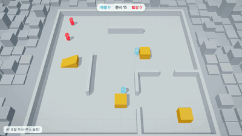

# Video to Game

A skill that teaches coding agents to turn a gameplay video into a real game you can play in the browser.
A video model designs the game (its look, camera and one memorable mechanic); the agent studies the clip frame by
frame, generates every image, 3D model and sound with fal to match it, writes the game in Three.js, then plays it
with the keyboard and films its best seconds as proof. It works with Claude Code, Codex, Cursor, Gemini and others.

**Play the 31 games:** [fal-video-to-game.vercel.app](https://fal-video-to-game.vercel.app)


31 original games, every one rebuilt from a 10 to 15 s video generated with MiniMax H3 Max on fal: 1,013 fal calls
(594 images, 194 3D models, 290 sounds and music tracks), 202 USD in total, about 6 USD per game. Every game is a
single `index.html` with Three.js and nothing else: no engine, no template, no other library.

## Why

Agents cannot design a game's look. Asked for "a game where a boy glides between flying whales", they ship grey
boxes, a default sky and a camera that fights the player. A video model is good at exactly that part, so let it go
first, and make the agent match it:

- **The video is the design document.** `study_video.py` turns it into frames, a contact sheet, a palette and
  cut times; the agent writes a spec (camera, hero, the one mechanic, the key moment, the look) from named frames.
- **Every asset comes from fal, from the video's own frames.** Concept sheets with Nano Banana Pro, clean cutouts,
  image to 3D (Meshy, Tripo, Hunyuan 3D), rigging and animations, sound effects and music, all logged with
  `fal_asset.py`. Nothing drawn by hand, nothing downloaded.
- **The look is a spec, not polish.** Tone mapping, one grade, fog, bloom, vignette and grain from the first scene,
  and a side-by-side picture of the video and the game at the same three spots after every change.
- **Calm the world so the game reads.** One harmonized palette, dense but grouped, the hero and everything you can
  interact with standing out on a quiet background. No text on screen.
- **The agent plays its own game.** A keyboard scenario reads `window.__game` like a player reads the screen,
  `record_play.mjs` films it at the real frame rate, `best_window.py` finds the liveliest seconds. Falls, walls and
  dead seconds get fixed before anyone else plays.

## The gallery

Each GIF is the generated video (left) and the game (right). Click for the prompt, the fal models and the cost.

| | |
|---|---|
| [](gallery/skyfarer/) | [](gallery/tidebound/) |
| **Skyfarer** · 8.93 USD · [play](https://fal-video-to-game.vercel.app/O2_3D_SKYFARER/) · [code](gallery/skyfarer/game/)<br>Courier boy running and gliding between giant flying whales above the clouds. | **Tidebound** · 11.01 USD · [play](https://fal-video-to-game.vercel.app/H01_TIDEBOUND_coop2/) · [code](gallery/tidebound/game/)<br>Two-player co-op sailing game: two sailors crew a living ship grown from pink coral. One player steers the… |
| [](gallery/storm-surfer/) | [](gallery/skyhook-rescue/) |
| **Storm Surfer** · 4.38 USD · [play](https://fal-video-to-game.vercel.app/S30_STORM-SURFER/) · [code](gallery/storm-surfer/game/)<br>Photorealistic 3D game, cutting-edge real-time rendering quality, real-world materials: a surfer on a glowing… | **Skyhook Rescue** · 10.43 USD · [play](https://fal-video-to-game.vercel.app/D01_SKYHOOK-RESCUE_coop2/) · [code](gallery/skyhook-rescue/game/)<br>Two-player co-op rescue game during a thunderstorm: two small airships linked by a long cable fly together… |
| [](gallery/paper-dragon/) | [](gallery/bubble-balloon/) |
| **Paper Dragon** · 0.79 USD · [play](https://fal-video-to-game.vercel.app/B06_PAPER-DRAGON/) · [code](gallery/paper-dragon/game/)<br>A girl rides a long red paper dragon kite through an autumn canyon, the dragon's paper body rippling as it… | **Bubble Balloon** · 2.18 USD · [play](https://fal-video-to-game.vercel.app/B10_BUBBLE-BALLOON/) · [code](gallery/bubble-balloon/game/)<br>A child floats inside a giant soap bubble over a sunny seaside village, steering it by leaning, bouncing… |
| [](gallery/kite-rider/) | [](gallery/aurora-skiff/) |
| **Kite Rider** · 4.09 USD · [play](https://fal-video-to-game.vercel.app/S16_KITE-RIDER/) · [code](gallery/kite-rider/game/)<br>Watercolor-shaded 3D game: a girl stands on a giant kite, surfing the wind high above rice terraces, leaning… | **Aurora Skiff** · 2.79 USD · [play](https://fal-video-to-game.vercel.app/B08_AURORA-SKIFF/) · [code](gallery/aurora-skiff/game/)<br>A nomad steers a small sand skiff with a cloth sail across glowing blue dunes at night, catching the wind… |
| [](gallery/glass-greenhouse/) | [](gallery/bell-tower/) |
| **Glass Greenhouse** · 2.34 USD · [play](https://fal-video-to-game.vercel.app/B03_GLASS-GREENHOUSE/) · [code](gallery/glass-greenhouse/game/)<br>A tiny robot gardener tends a greenhouse inside a floating glass sphere above the clouds; it opens glass… | **Bell Tower** · 7.27 USD · [play](https://fal-video-to-game.vercel.app/A14_BELL-TOWER/) · [code](gallery/bell-tower/game/)<br>A bell-ringer swings on long ropes inside a giant pastel bell tower; each bell she rings sends a wave of… |
| [](gallery/fog-shepherd/) | [](gallery/paper-moon-stairs/) |
| **Fog Shepherd** · 5.04 USD · [play](https://fal-video-to-game.vercel.app/A07_FOG-SHEPHERD/) · [code](gallery/fog-shepherd/game/)<br>A cloaked figure with a lantern guides a herd of glowing white deer through a monochrome foggy forest; only… | **Paper Moon Stairs** · 6.13 USD · [play](https://fal-video-to-game.vercel.app/A02_PAPER-MOON-STAIRS/) · [code](gallery/paper-moon-stairs/game/)<br>A girl in a long white dress climbs a staircase of drifting paper lanterns into a pastel night sky; each… |
| [](gallery/whale-song/) | [](gallery/sky-library/) |
| **Whale Song** · 5.45 USD · [play](https://fal-video-to-game.vercel.app/A09_WHALE-SONG/) · [code](gallery/whale-song/game/)<br>A diver in a red scarf swims beside a giant translucent ghost whale through a deep blue gradient ocean; the… | **Sky Library** · 5.75 USD · [play](https://fal-video-to-game.vercel.app/A06_SKY-LIBRARY/) · [code](gallery/sky-library/game/)<br>A girl swims through warm air between towering floating bookshelves; loose pages flutter like birds and she… |
| [](gallery/kintsugi-mountain/) | [](gallery/space-mower/) |
| **Kintsugi Mountain** · 8.60 USD · [play](https://fal-video-to-game.vercel.app/A01_KINTSUGI-MOUNTAIN/) · [code](gallery/kintsugi-mountain/game/)<br>A small monk walks up a black-and-white ink-wash mountain; every footstep blooms gold leaf, and golden… | **Space Mower** · 8.25 USD · [play](https://fal-video-to-game.vercel.app/S28_SPACE-MOWER/) · [code](gallery/space-mower/game/)<br>Bright stylized 3D game on a tiny round green asteroid: an astronaut drives a little lawn mower around the… |
| [](gallery/ember-path/) | [](gallery/clockwork-heist/) |
| **Ember Path** · 10.03 USD · [play](https://fal-video-to-game.vercel.app/A13_EMBER-PATH/) · [code](gallery/ember-path/game/)<br>A girl carrying a small glowing ember walks through a charcoal-drawn burnt forest; the ember redraws the… | **Clockwork Heist** · 9.03 USD · [play](https://fal-video-to-game.vercel.app/H02_CLOCKWORK-HEIST_4p/) · [code](gallery/clockwork-heist/game/)<br>Four-player co-op heist game inside a colossal clock tower: four small thieves in red, blue, yellow and green… |
| [](gallery/starlight-train/) | [](gallery/dune-surfer/) |
| **Starlight Train** · 2.48 USD · [play](https://fal-video-to-game.vercel.app/B04_STARLIGHT-TRAIN/) · [code](gallery/starlight-train/game/)<br>A little spirit in a white cloak rides on the roof of a night train crossing snowy mountains, jumping from… | **Dune Surfer** · 8.10 USD · [play](https://fal-video-to-game.vercel.app/S11_DUNE-SURFER/) · [code](gallery/dune-surfer/game/)<br>Low-poly desert 3D game at sunset, flat-shaded orange and purple dunes rolling like ocean waves: a hooded… |
| [](gallery/autumn-wind/) | [](gallery/stained-glass/) |
| **Autumn Wind** · 10.20 USD · [play](https://fal-video-to-game.vercel.app/A10_AUTUMN-WIND/) · [code](gallery/autumn-wind/game/)<br>A child in a cloak of orange leaves surfs the wind over golden hills with a swirling swarm of leaves, painted… | **Stained Glass** · 8.67 USD · [play](https://fal-video-to-game.vercel.app/A03_STAINED-GLASS/) · [code](gallery/stained-glass/game/)<br>A tiny cloaked figure crosses a vast empty cathedral; sunlight through stained glass windows casts colored… |
| [](gallery/deep-lights/) | [](gallery/snow-globe/) |
| **Deep Lights** · 4.66 USD · [play](https://fal-video-to-game.vercel.app/S12_DEEP-LIGHTS/) · [code](gallery/deep-lights/game/)<br>Bioluminescent deep-sea 3D game, dark navy water, simple glowing shapes: a small yellow submarine touches… | **Snow Globe** · 6.15 USD · [play](https://fal-video-to-game.vercel.app/A12_SNOW-GLOBE/) · [code](gallery/snow-globe/game/)<br>A tiny figure lives inside a snow globe; the whole world slowly turns upside down, the snow falls upward and… |
| [](gallery/sunflower-silhouette/) | [](gallery/rust-bloom/) |
| **Sunflower Silhouette** · 4.68 USD · [play](https://fal-video-to-game.vercel.app/A15_SUNFLOWER-SILHOUETTE/) · [code](gallery/sunflower-silhouette/game/)<br>A small silhouette child runs through a field of giant sunflowers at golden hour, jumping across huge petals… | **Rust Bloom** · 8.45 USD · [play](https://fal-video-to-game.vercel.app/A05_RUST-BLOOM/) · [code](gallery/rust-bloom/game/)<br>A small grey robot wanders a colorless ruined city with a watering can; wherever it pours, rust turns into… |
| [](gallery/ink-fox/) | [](gallery/mirror-sea/) |
| **Ink Fox** · 3.14 USD · [play](https://fal-video-to-game.vercel.app/S08_INK-FOX/) · [code](gallery/ink-fox/game/)<br>Monochrome ink-wash 3D game, black ink on white rice paper with a single red accent: a small white fox spirit… | **Mirror Sea** · 10.02 USD · [play](https://fal-video-to-game.vercel.app/A04_MIRROR-SEA/) · [code](gallery/mirror-sea/game/)<br>A boy walks barefoot across an endless mirror-calm sea at dawn; each step sends ripples that reveal faint… |
| [](gallery/cloud-shepherd/) | [](gallery/train-painter/) |
| **Cloud Shepherd** · 4.27 USD · [play](https://fal-video-to-game.vercel.app/S17_CLOUD-SHEPHERD/) · [code](gallery/cloud-shepherd/game/)<br>Soft pastel 3D game: a shepherd with a long crook herds fluffy little clouds like sheep across a blue sky… | **Train Painter** · 15.48 USD · [play](https://fal-video-to-game.vercel.app/S22_TRAIN-PAINTER/) · [code](gallery/train-painter/game/)<br>Bright cartoon 3D game: a tiny steam train lays its own rail tracks in front of it as it moves, the player… |
| [](gallery/hourglass/) | [](gallery/hide-and-seek/) |
| **Hourglass** · 3.22 USD · [play](https://fal-video-to-game.vercel.app/A08_HOURGLASS/) · [code](gallery/hourglass/game/)<br>A tiny wanderer walks inside a giant glass hourglass; golden sand pours from above and piles into dunes that… | **Box Fort** · 0 USD · [details](gallery/hide-and-seek/) · [code](gallery/hide-and-seek/game/)<br>Team hide-and-seek with boxes, a ramp and locks; every AI character is decided by Jev (TypeSafe), or a local brain without a key. Game only on the poster (the source clip is OpenAI footage). |

## Install

**Claude Code** (plugin marketplace):

```bash
claude plugin marketplace add lovisdotio/video-to-game
```

```bash
claude plugin install video-to-game@video-to-game
```

Or copy the skill: `cp -R skills/video-to-game ~/.claude/skills/`.

**Codex, Cursor, Gemini CLI, Copilot and other agents** (via [skills](https://github.com/vercel-labs/skills)):

```bash
npx skills add lovisdotio/video-to-game
```

Or copy `skills/video-to-game` into your agent's skills folder (`~/.agents/skills/` for Codex, `~/.cursor/skills/`
for Cursor).

The scripts need Python 3.9+, ffmpeg, Node 18+ with `playwright-core` for the recorder, and
`pip install fal-client` with a `FAL_KEY` ([fal.ai/dashboard/keys](https://fal.ai/dashboard/keys)) for the assets.

## Use

> Turn `gameplay.mp4` into a playable browser game with the video-to-game skill. The prompt that made it is in
> `gameplay.txt`. Generate every asset with fal, match the video's look, and show me side-by-side pairs and a
> recorded take of you playing it.

No video yet? Start from `prompts/gameplay-video-prompts.md`: the rules that made these 31 videos rebuildable,
and every prompt used.

## Layout

```text
skills/video-to-game/
  SKILL.md                 workflow, hard rules, reference routing
  references/              study the video, fal assets, game loop, look and post-processing, playtest
  scripts/                 study_video.py, fal_asset.py, side_by_side.py, best_window.py, record_play.mjs
  templates/               game.html (Three.js skeleton with post stack and state contract), play.mjs
gallery/<game>/            poster.gif, README.md (prompt, controls, fal calls, cost), game/ (the code)
prompts/                   gameplay video prompts
examples/plays/            real playtest scenarios from the gallery
```

## Credits

Videos generated with MiniMax H3 Max and Seedance 2.5 on [fal](https://fal.ai). Games, assets pipeline and
playtests by Claude Opus 5.5 with fal. Made by [Lovis Odin](https://github.com/lovisdotio).

MIT license.
